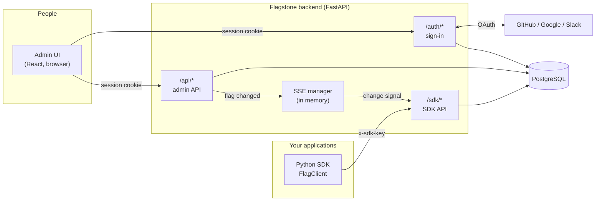
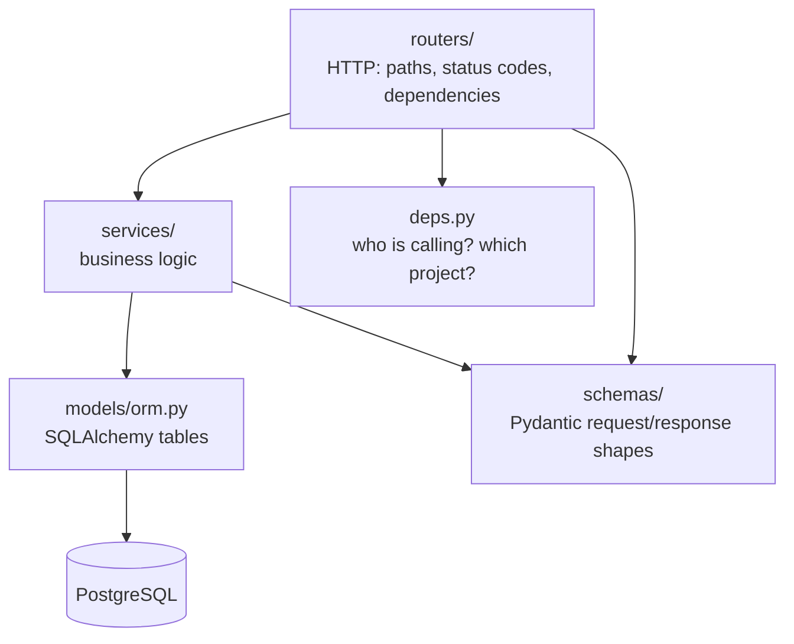
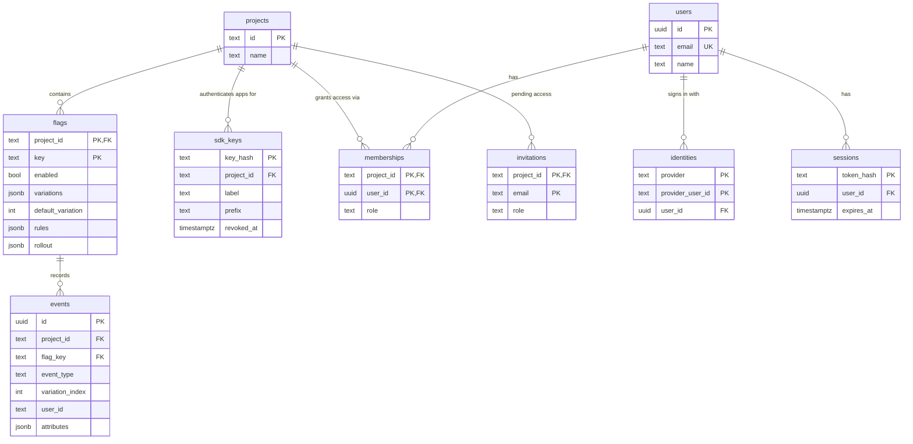
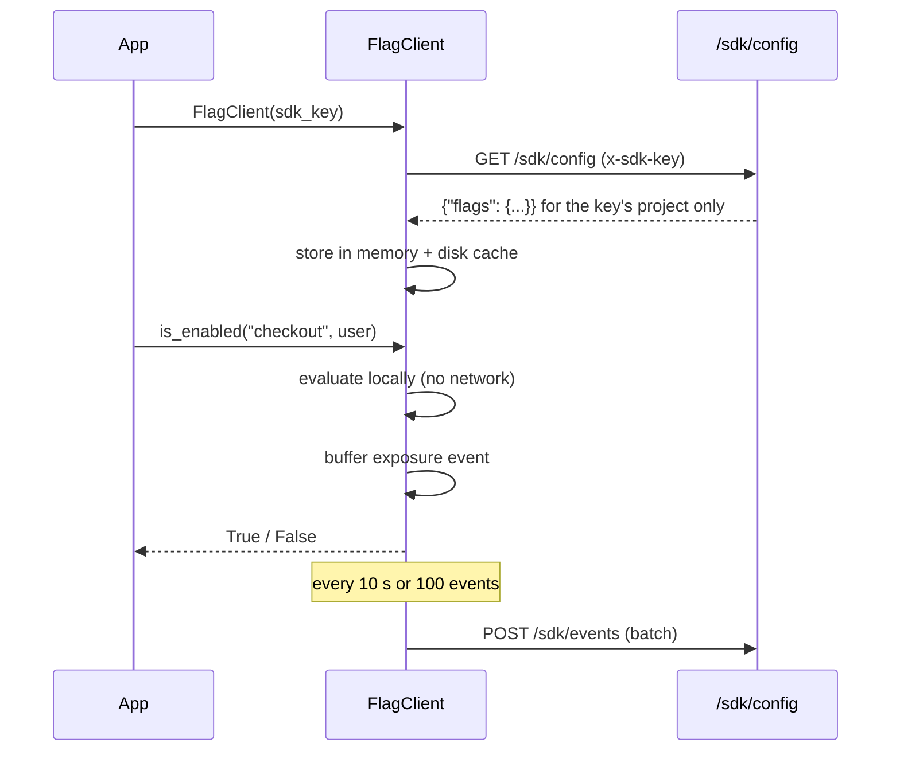

# Architecture

Flagstone has four parts: a **FastAPI backend**, a **PostgreSQL database**, a **React admin UI** used by people, and a **Python SDK** embedded in your applications.



There are two separate audiences with two separate credentials:

| Audience | Uses | Authenticates with | Can do |
| --- | --- | --- | --- |
| People (admins, viewers) | Admin UI → `/auth/*`, `/api/*` | Session cookie from OAuth sign-in | Manage flags, keys and members of projects they belong to |
| Applications | SDK → `/sdk/*` | `x-sdk-key` header | Read one project's flags, report events for them |

Both are scoped to a **project**; see [Authentication and access control](authentication.md).

## Components

### Backend (`backend/`)

A single FastAPI application, built by `create_app()` in `backend/main.py`. It is organised in layers, and each layer only calls the one below it:



- **Routers** translate HTTP into service calls. They hold no business rules, only request parsing, permission dependencies and response models.
- **Services** hold the logic: flag CRUD, evaluation, analytics, sign-in, projects and SDK keys. Each module is described in [Backend services](backend-services.md).
- **`deps.py`** answers two questions for every request: who is calling (session user or SDK key), and which project they may act on.
- **Schemas** (Pydantic) validate input and define the JSON the API returns.
- **Models** (SQLAlchemy 2, async) map Python classes to tables.

### Database (PostgreSQL + Alembic)

All persistent state lives in PostgreSQL. The schema is created and evolved by Alembic migrations in `alembic/versions/`, numbered `001` to `005`. Tests use in-memory SQLite created straight from the ORM models, so the models and migrations must be kept in sync by hand.

### Admin UI (`frontend/`)

A React 18 + TypeScript single-page app built with Vite. In development, Vite serves it on port 5173 and proxies `/api`, `/auth` and `/sdk` to the backend, so the browser sees one origin and the session cookie just works. See [Frontend](frontend.md).

### Python SDK (`sdk/`)

`FlagClient` downloads a project's full flag configuration and **evaluates flags locally**, in your application's process. A flag check is a dictionary lookup plus a few comparisons, with no network call. The SDK refreshes its copy by polling or over Server-Sent Events, keeps a disk cache in case the backend is down at startup, and batches analytics events. See [How it works](how-it-works.md#4-the-sdk).

## Data model



The design points worth knowing:

- **Flags are keyed by `(project_id, key)`.** The same key, such as `checkout`, can exist in several projects independently.
- **Events reference flags with a composite foreign key** `(project_id, flag_key) → flags(project_id, key)`. The database itself guarantees an event can't be attributed to another project's flag, and deleting a flag deletes its events.
- **Flag targeting is stored as JSON** (`variations`, `rules`, `rollout`). It is always read and written as a whole and never queried inside, so separate tables would add joins for no benefit.
- **Secrets are stored hashed.** `sdk_keys.key_hash` and `sessions.token_hash` are SHA-256 hashes; the raw values exist only on the client.
- **Users are separate from how they sign in.** One `users` row can have several `identities` (GitHub, Google…), linked by verified email.

## Request flows

### An admin changes a flag

```mermaid
sequenceDiagram
    participant UI as Admin UI
    participant API as /api/projects/{id}/flags/{key}
    participant Deps as deps.py
    participant Svc as flag_service
    participant DB as PostgreSQL
    participant SSE as SSE manager
    participant SDK as SDK (SSE mode)

    UI->>API: PUT {rules, rollout…} + cookie + X-Requested-With
    API->>Deps: project_admin()
    Deps->>DB: session → user; membership(project, user)
    Deps-->>API: ProjectAccess(role=admin)
    API->>Svc: update_flag(project_id, key, data)
    Svc->>DB: UPDATE flags … COMMIT
    API->>SSE: broadcast("project:{id}", {"event":"updated","key":…})
    API-->>UI: 200 updated flag
    SSE-->>SDK: event: flag_updated
    SDK->>SDK: refetch /sdk/config
```

Polling SDKs pick up the change on their next poll, 30 seconds by default.

### An application checks a flag



### A person signs in

Covered step by step in [Authentication and access control](authentication.md#sign-in-flow).

## Process and deployment model

- **One stateless-ish API process.** Everything is in PostgreSQL except the SSE subscriber list, which is held in memory (see [design decisions](design-decisions.md#sse-fan-out-is-in-process)).
- **Startup** (`lifespan` in `backend/main.py`) creates the database engine and SSE manager, then runs `bootstrap`, which ensures the Default project exists and seeds the `SDK_KEY` setting as one of its keys. Migrations must already have run; Docker Compose runs `alembic upgrade head` first for this reason.
- **Same origin in production.** Serve the built UI (`frontend/dist`) and route `/api`, `/auth` and `/sdk` to the backend under one domain. The session cookie and CSRF protection assume this.
