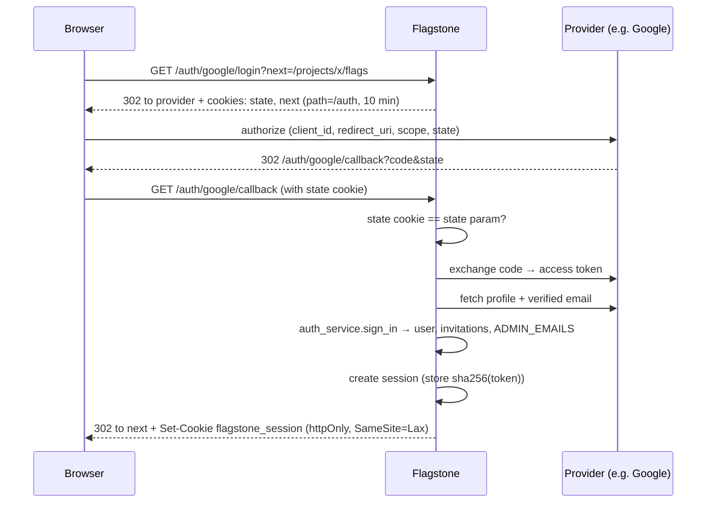

# Authentication and access control

Flagstone authenticates two different callers in two different ways, and scopes both to a **project**.

| | People | Applications |
| --- | --- | --- |
| Endpoints | `/auth/*`, `/api/*` | `/sdk/*` |
| Credential | Session cookie, obtained via GitHub / Google / Slack sign-in | `x-sdk-key` header |
| Resolved to | a user + their role in the project in the URL | exactly one project |
| Checked in | `deps.py`: `get_current_user`, `project_viewer`, `project_admin` | `routers/sdk.py`: `_verify_sdk_key` |

## Project isolation

The core guarantee: **an admin and an SDK key only ever reach the project they belong to.**

- **People:** every admin route resolves `project_id` from the URL and requires a membership row for `(project_id, user)`. Non-members get 404, the same answer as for a project that doesn't exist.
- **Applications:** the SDK key is hashed and looked up; the request is then served for **that key's project**. The request can't name a project, so there is nothing to tamper with.
- **Data:** every flag query filters by `project_id`, and the database enforces that an event's `(project_id, flag_key)` refers to a flag in the same project.
- **Change notifications:** SSE streams subscribe to `project:{id}`, so one project's changes, or even its flag names, never reach another project's applications.

`tests/test_auth_projects.py` covers each of these.

## Roles

| Role | Can |
| --- | --- |
| **viewer** | See flags, targeting, results, SDK key metadata and members; use "Test a user" |
| **admin** | Everything a viewer can, plus: create, edit, toggle and delete flags; create and revoke SDK keys; invite, re-role and remove members; rename and delete the project |

A project always keeps at least one admin; the API refuses to demote or remove the last one.

## Sign-in flow

What each check protects against:

| Check | Protects against |
| --- | --- |
| `state` cookie must equal the `state` parameter | Login CSRF: an attacker tricking you into signing in as *them* |
| `next` must be a relative path (`/…`, not `//…`) | Open redirect via the login link |
| Verified email required | Someone claiming another person's email at a provider that doesn't verify it, then inheriting their invitations or admin rights |
| Redirect URI fixed from `PUBLIC_URL` | Codes being sent anywhere other than this deployment |

## Sessions

- The cookie `flagstone_session` holds a random 256-bit token. The database stores only its SHA-256, with an expiry (`SESSION_TTL_HOURS`, 7 days by default). A database leak doesn't hand out live sessions.
- Cookie flags: `HttpOnly` (not readable by JavaScript), `SameSite=Lax`, `Secure` when `COOKIE_SECURE=true`.
- Sign-out deletes the session row, so a copied cookie stops working immediately. Expired sessions are deleted when next presented.

## CSRF protection

Cookie-authenticated APIs are open to cross-site request forgery: another site can submit a form to your API and the browser attaches the cookie. Two layers prevent this:

1. `SameSite=Lax` stops the cookie from being sent on cross-site `POST`, `PUT` and `DELETE`.
2. Every non-`GET` admin request must carry `X-Requested-With: flagstone`. Browsers only let another origin send a custom header after a CORS preflight, and Flagstone never approves one.

The UI adds the header automatically in `frontend/src/api/http.ts`. Scripts calling the admin API must add it too.

## Getting access

| How | Result |
| --- | --- |
| Email in `ADMIN_EMAILS` | Admin of the Default project at each sign-in. This is how the first admin gets in. |
| Create a project | Admin of that project |
| Invited by an admin | Membership straight away if they've signed in before; otherwise an invitation, applied at their first sign-in with that email |
| None of the above | Signed in with no projects. They can create their own. |

## SDK keys

- Format `fs_` + 32 URL-safe random characters. Shown **once** at creation; stored as SHA-256 with a short display prefix such as `fs_Ab3dE…`.
- Revoking sets `revoked_at`; the next SDK request with that key gets 401. The SDK keeps serving its last configuration from memory or the disk cache.
- `last_used_at` is updated at most every 5 minutes, so you can see whether a key is still in use before revoking it.
- The `SDK_KEY` setting is seeded as a Default-project key at startup, so applications configured before projects existed keep working.

## Development sign-in

`DEV_LOGIN=true` enables `POST /auth/dev-login`: sign in as any email, no password. It exists so the app can be run and tested without registering OAuth apps. It is off by default, Docker Compose turns it on for local use, and it must **never** be enabled on a server others can reach.

## Provider setup

Step-by-step registration for GitHub, Google and Slack is in the [project README](../README.md#configuring-sign-in-providers). The callback URL is always `{PUBLIC_URL}/auth/{provider}/callback`.
