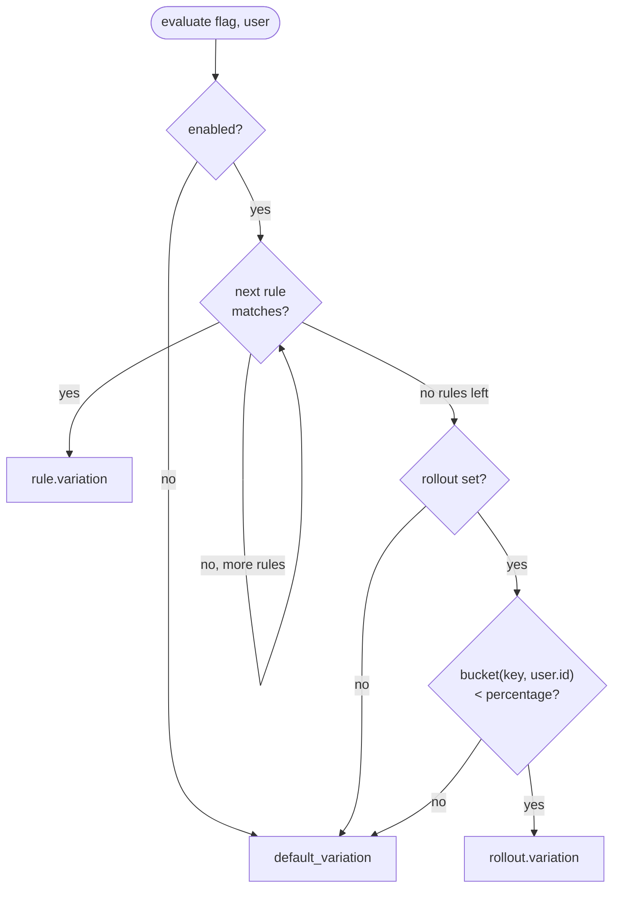
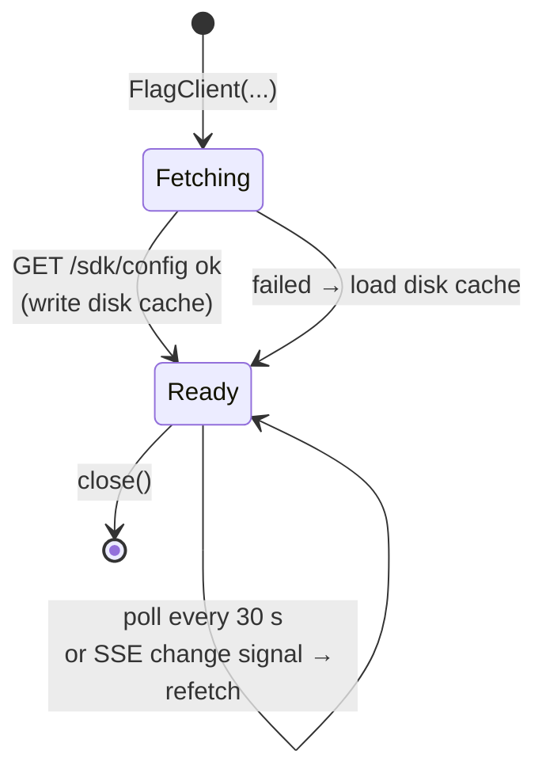

# How it works

This document follows a flag from creation to experiment results.

## 1. A flag

A flag is stored as one row; its targeting is JSON:

```json
{
  "key": "new-checkout",
  "enabled": true,
  "variations": [false, true],
  "default_variation": 0,
  "rules": [
    { "attribute": "plan",    "operator": "equals", "value": "enterprise", "variation": 1 },
    { "attribute": "country", "operator": "in",     "value": ["US", "CA"], "variation": 1 }
  ],
  "rollout": { "variation": 1, "percentage": 20 }
}
```

- **`variations`** can hold any JSON values: booleans, strings such as `"control"`/`"treatment"`, numbers or objects. Everything else refers to a variation by its **index**.
- **`enabled: false`** is a kill switch: everyone gets `default_variation`, whatever the rules say.
- **`rollout`** is optional. Without it, users who match no rule get the default.

## 2. Evaluation

The same algorithm exists twice, in `sdk/evaluator.py`, which applications run, and in `backend/services/evaluator.py`, which the admin UI's "Test a user" uses. `tests/test_evaluator.py` and `tests/test_bucketing.py` check that the two agree.



The rule operators:

| Operator | Matches when | Example |
| --- | --- | --- |
| `equals` | `user[attr] == value` | `plan equals "pro"` |
| `contains` | the attribute is a string and contains `value` | `email contains "@acme.com"` |
| `gt` / `lt` | the attribute is a number greater / less than `value` | `age gt 18` |
| `in` | the attribute is one of the values in the list | `country in ["US", "CA"]` |

A missing attribute never matches `contains`, `gt` or `lt`, and matches `equals` only if `value` is `null`.

The function returns an **index**. `is_enabled` turns it into a boolean with `bool(variations[index])`; `get_variation` returns the index itself.

## 3. Rollout bucketing

```python
def bucket(flag_key, user_id):
    digest = md5(f"{flag_key}:{user_id}".encode()).hexdigest()
    return int(digest[:8], 16) % 100      # 0–99

in_rollout = bucket(flag_key, user_id) < percentage
```

This gives three properties a rollout needs:

1. **Deterministic.** The same user always lands in the same bucket, on any server, in any process, with no stored state. A user doesn't flicker between variations.
2. **Monotonic.** Raising the percentage from 20 to 50 only *adds* users (buckets 20–49); everyone already in stays in. That's what makes a gradual rollout safe.
3. **Independent per flag.** The flag key is part of the hash, so being in the first 20% of one flag says nothing about another flag. Experiments don't overlap systematically.

MD5 is used for its even distribution, not for security. Nothing about bucketing is secret.

Users without an `id` all share the bucket of the empty string, so they're either all in or all out. Always pass a stable `id`.

## 4. The SDK

`FlagClient` (`sdk/client.py`) holds a full copy of its project's flags in memory.



**Getting the configuration**
- On creation it calls `GET /sdk/config` once. If that fails, for example because the backend is down while your app starts, it falls back to the last configuration saved on disk (`~/.flagstone_cache.json`). If there's no cache either, every flag evaluates as unknown: `is_enabled` returns `False`.
- The disk cache is written atomically, to a temp file and then renamed, so a crash mid-write can't leave a corrupt cache.

**Keeping it fresh** (choose one with `use_sse`)
- **Polling** (default): `Poller` refetches every `poll_interval` seconds (30). Simple, and works through any proxy.
- **SSE**: `StreamListener` keeps a `GET /sdk/stream` connection open. The server sends a small change signal (`{"event": "updated", "key": …}`), not the flag itself, and the client refetches the full config. A `deleted` signal removes the flag locally without a fetch. On disconnect it reconnects with exponential backoff, 1 s doubling up to 60 s. The server sends a `ping` every 15 s so idle connections aren't closed by proxies.

**Evaluating**: `is_enabled` reads the in-memory flag under a lock and evaluates locally. A network outage after startup never slows down or breaks flag checks; the client just keeps the last configuration it had.

**Recording events**
- `is_enabled` buffers an **exposure**; `track_conversion` buffers a **conversion**. `get_variation` records nothing.
- The buffer is sent as one batch to `POST /sdk/events` when it reaches 100 events, or every `flush_interval` seconds (10).
- Delivery is best-effort: if the POST fails, that batch is dropped. Flag checks are never blocked by analytics.

## 5. Change propagation

When an admin saves a flag, the router calls `SSEConnectionManager.broadcast("project:{id}", …)`. The manager puts the message on the queue of every stream subscribed to that project's channel, and only that project's. Each SDK stream's generator reads its queue and sends the SSE event.

| SDK mode | Typical delay after a save |
| --- | --- |
| SSE | well under a second |
| Polling | up to `poll_interval` (30 s by default) |

## 6. Events and experiment results

`POST /sdk/events` accepts up to 1,000 events per request. Events are tagged with the SDK key's project. Events for flags that don't exist in that project are dropped and counted as `rejected`.

`GET /api/projects/{id}/experiments/{key}/results` aggregates in a single SQL query:

```sql
SELECT variation_index,
       COUNT(*) FILTER (WHERE event_type = 'exposure')   AS exposures,
       COUNT(*) FILTER (WHERE event_type = 'conversion') AS conversions
FROM events
WHERE project_id = :project AND flag_key = :key
GROUP BY variation_index
```

Conversion rate is `conversions / exposures × 100`, rounded to two decimals. The UI adds each variation's lift relative to the default variation.

Interpret results with care:
- **Counts are events, not unique users.** A user checked ten times counts as ten exposures. Rates are most meaningful when each user converts at most once and you compare variations under similar traffic.
- **No significance test** is applied, so small samples can show large, meaningless differences.
- `track_conversion` re-evaluates the flag at conversion time. If targeting changed in between, the conversion may be attributed to a different variation than the user saw.

## 7. A complete example

1. An admin creates `new-checkout` in project *Shop*, adds a rule `plan equals "enterprise" → true` and a 20% rollout of `true`, and turns it on.
2. The Shop backend runs `FlagClient(sdk_key="fs_…")` with a key from Shop's SDK keys page. It receives only Shop's flags.
3. For `{"id": "u42", "plan": "free"}`, no rule matches. `bucket("new-checkout", "u42")` is, say, 13, which is below 20, so the user is in the rollout: `True`. An exposure for variation 1 is buffered.
4. `u42` checks out; the app calls `track_conversion("new-checkout", user)`.
5. Within 10 seconds both events reach `/sdk/events`. The Results tab shows them under variation 1.
6. The rollout looks healthy, so the admin raises it to 50%. SSE clients refetch immediately; `u42` stays in, and buckets 20–49 join.
